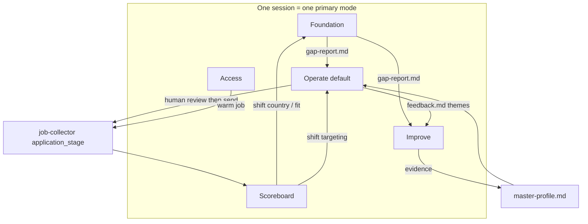

# jobHunter — Emad Poursina

Personal workflow for finding, qualifying, and applying to **backend / full-stack JavaScript** roles with **migration via job offer** (employer visa sponsorship required).

## Target role

- **Primary:** Backend / Node.js engineer (NestJS path)
- **Secondary:** Full-stack JavaScript (React, Next.js, TypeScript)
- **Experience band:** 7+ years, mid–senior
- **Migration path:** Employer visa sponsorship (Iranian passport)
- **Upskilling:** One flagship project — see [`phase3/skill-map.md`](phase3/skill-map.md) and [`phase3/flagship-project.md`](phase3/flagship-project.md)

---

## Operating model — five session modes

Pick **one primary mode per session**. Default = **Operate** (most sessions send applications).

| Mode | Folder(s) | Spec |
|------|-----------|------|
| Foundation — market + visa + gaps | `phase1/` | `docs/agents/job-offer-research.md` |
| Operate — applications out (**default**) | `phase2/` + `tools/job-collector/` | `docs/agents/cv-generator.md` |
| Improve — close gaps + evidence | `phase3/` | `docs/agents/project-profile-extractor.md` |
| Access — warm intros / referrals | `networking/` | — |
| Scoreboard — conversion by country | `metrics/` | counts from job-collector `application_stage` |

Folders stay as-is; "Phase 0–3" below are these modes mapped to their existing folders, not four equal parallel phases.

**Four sources of truth (named once, used consistently):**

- Who you are: `phase2/profile/master-profile.md`
- Market vs you: `phase1/skills/gap-report.md`
- Funnel stage: job-collector `application_stage` on jobs (SQLite)
- What to learn next: `phase3/backlog.md`

Supporting (not sources of truth): `phase1/skills/requirements-summary.md`, `phase1/checklist.md`, `phase2/applications/feedback.md`, `phase3/skill-map.md`, `phase3/flagship-project.md`, `metrics/by-country.md`, `networking/contacts.md` + `networking/outreach-log.md`. Legacy unused: `phase2/applications/pipeline.md` — do not sync or revive.

**Hard rules:**

1. 100% human review of CV, cover letter, and follow-up before send. No exceptions.
2. Never modify offer files after they are submitted. Log learning in `phase2/applications/feedback.md`.
3. Do not wait for all skill gaps to close before applying.
4. One primary mode per session. Default = Operate.
5. Master profile is the only source of facts for CVs.

---

## Project architecture overview

Five modes share one loop, mapped to the folders below. **Default session = Operate.** Improve runs on its own cadence; do not wait until all skill gaps are closed before applying.



### Mode: Access — Networking & referrals (folder `networking/`, formerly "Phase 0")

**Goal:** Access hidden market and warm introductions alongside cold applications.

| Step | Description |
|------|-------------|
| 0.1 | Map diaspora communities, local tech meetups (virtual), and LinkedIn contacts in priority countries. |
| 0.2 | Track outreach and referrals; note who referred which company or role. |
| 0.3 | Prefer referred or warm paths when available; still run Phase 2 for direct applications in parallel. |

**Outputs:** Contact list, outreach log, referral links to applications.

**Folder:** [`networking/`](networking/)

---

### Mode: Foundation — Research & skill gap analysis (folder `phase1/`)

**Goal:** Understand demand, visa feasibility, and skill expectations before scaling applications.

| Step | Description |
|------|-------------|
| 1.1 | Choose **five priority countries**; apply elsewhere too, but weight effort toward these five. |
| 1.2 | Per priority country, collect **10–15 representative job offers** for backend / full-stack roles (same seniority band, posted within ~90 days, credible sources). |
| 1.3 | For each country, record **immigration context**: typical work-permit route via job offer, language threshold, sponsorship likelihood. |
| 1.4 | Extract skills, experience, certifications, and language requirements from the corpus. |
| 1.5 | Compare against your profile → **skill gap report** (missing, weak, strong). |

**Representative offer rules**

- Title family: Backend Engineer, Software Engineer (backend-leaning), Full-Stack Developer
- Consistent seniority (e.g. mid or senior — pick one band per sampling round)
- Sources: company careers pages, LinkedIn, national job boards — not aggregator spam

**Outputs:** Priority country files, job-offer research corpus, skill gap report.

**Folder:** [`phase1/`](phase1/)

**Agent:** [`docs/agents/job-offer-research.md`](docs/agents/job-offer-research.md) — collects 10–15 verified offers per country into `phase1/job-offers/by-country/<code>/research.md`.

---

### Mode: Operate — Profile, tailored applications & pipeline (folders `phase2/` + `tools/job-collector/`, default mode)

**Goal:** One consistent identity; every application customized and reviewed.

| Step | Description |
|------|-------------|
| 2.1 | Maintain a **master profile** — single source of truth for experience, projects, education, skills, languages, authorization notes. |
| 2.2 | For each offer: AI generates a **job-specific CV** (optional cover letter) from master profile + offer text. |
| 2.3 | **100% human review** before every send — no unreviewed AI output. |
| 2.4 | Submit and **track pipeline**: sent → response → screening → interview → offer / rejection. |
| 2.5 | Log **recruiter and interview feedback**; feed recurring themes back into Phase 1 sampling and Phase 3 priorities. |

**Outputs:** Master profile, reviewed CVs, application log, feedback notes.

**Folder:** [`phase2/`](phase2/)

**Agent:** [`docs/agents/cv-generator.md`](docs/agents/cv-generator.md) — reads master profile + offer file → `phase2/documents/generated/CV_<Company>_<Role>_<Date>.md`

---

### Mode: Improve — Close skill gaps, parallel with Operate (folder `phase3/`)

**Goal:** Reduce gaps from Phase 1 and real signals from Phase 2 while applications continue.

| Step | Description |
|------|-------------|
| 3.1 | Merge Phase 1 gap report with Phase 2 feedback (rejections, interview notes, new listings). |
| 3.2 | Prioritize by frequency in target jobs, effort, and visa / search deadlines. |
| 3.3 | Execute learning plan — courses, certs, portfolio projects, open source, language study. |
| 3.4 | Add evidence to master profile; re-sample offers periodically to confirm gaps are closing. |

**Outputs:** Learning backlog, completed items, updated profile, revised gap report.

**Folder:** [`phase3/`](phase3/)

---

### Mode: Scoreboard — metrics (folder `metrics/`; counts from job-collector `application_stage`)

Track per **priority country** and overall:

- Applications sent
- Response rate
- Interview rate
- Offer rate
- Time in pipeline

Use metrics to shift Phase 1 effort if a “priority” country underperforms.

**Folder:** [`metrics/`](metrics/)

---

## Repository structure

```
jobHunter/
├── README.md                          # This file — architecture & workflow
├── docs/
│   ├── principles.md                  # Decision log & workflow rules
│   └── agents/
│       ├── README.md
│       ├── job-offer-research.md      # Phase 1 — find offers per country
│       ├── cv-generator.md            # Phase 2 — tailored CV + Gaps Disclosure
│       └── project-profile-extractor.md
│
├── networking/                        # Mode: Access
│   ├── README.md
│   ├── contacts.md
│   └── outreach-log.md
│
├── phase1/                            # Mode: Foundation — skill gap analysis
│   ├── README.md
│   ├── checklist.md                   # Country selection & execution status
│   ├── countries/                     # Priority countries + visa notes
│   ├── job-offers/                    # Research corpus (by-country/*/research.md)
│   └── skills/                        # Gap report + market requirements
│
├── phase2/                            # Mode: Operate (default) — applications
│   ├── README.md
│   ├── profile/                       # Master profile
│   ├── offers/                        # Live offer files to apply to
│   ├── documents/                     # AI prompts & generated CVs
│   └── applications/                  # Pipeline tracking
│
├── phase3/                            # Mode: Improve — learning & gap closure
│   ├── README.md
│   ├── skill-map.md                   # Full curriculum + flagship layers
│   ├── backlog.md
│   └── flagship-project.md
│
└── metrics/                           # Mode: Scoreboard — conversion by country
    ├── README.md
    └── by-country.md
```

### How to use

1. Define five priority countries in `phase1/countries/` (copy `_country-template.md`).
2. Run the [job offer research agent](docs/agents/job-offer-research.md) per country → `phase1/job-offers/by-country/<code>/research.md`.
3. Merge market skills into `phase1/skills/requirements-summary.md`; reconcile with [`phase3/skill-map.md`](phase3/skill-map.md) → update [`phase1/skills/gap-report.md`](phase1/skills/gap-report.md).
4. Work [`phase3/backlog.md`](phase3/backlog.md) via [`phase3/flagship-project.md`](phase3/flagship-project.md) **in parallel** with applications.
5. Keep [`phase2/profile/master-profile.md`](phase2/profile/master-profile.md) updated as skills ship.
6. Create offer files from [`phase2/offers/_offer-template.md`](phase2/offers/_offer-template.md); run [CV generator agent](docs/agents/cv-generator.md) → `phase2/documents/generated/`.
7. Track applications in job-collector (`application_stage` on jobs), networking in `networking/`, metrics in `metrics/by-country.md`. (`phase2/applications/pipeline.md` is legacy / unused.)

---

## Status

**Foundation (2026-08 pivot):** Priority countries re-ranked toward **English-first markets — Canada, Ireland, UK, Netherlands, Portugal** — with **Germany demoted to secondary** while German is below B1 ([`phase1/countries/`](phase1/countries/)). Job-offer research complete for Canada, Netherlands, Portugal (30 offers); Germany (10) archived. Ireland + UK offers pending. Skill gap report updated ([`phase1/skills/gap-report.md`](phase1/skills/gap-report.md)).

**Operate (in progress):** Master profile complete ([`phase2/profile/master-profile.md`](phase2/profile/master-profile.md)) — relocation priority now Canada → Ireland → UK → Netherlands → Portugal. CV generator agent ready ([`docs/agents/cv-generator.md`](docs/agents/cv-generator.md)). Focus live offer collection on **Canada, Ireland, UK** before creating offer files in `phase2/offers/`.

**Next:** Ireland + UK job-offer research (0/10 each); close critical gaps (AWS, Jest, CI/CD) via [`phase3/backlog.md`](phase3/backlog.md) while Operate continues. Germany stays on hold until B1+ German.
